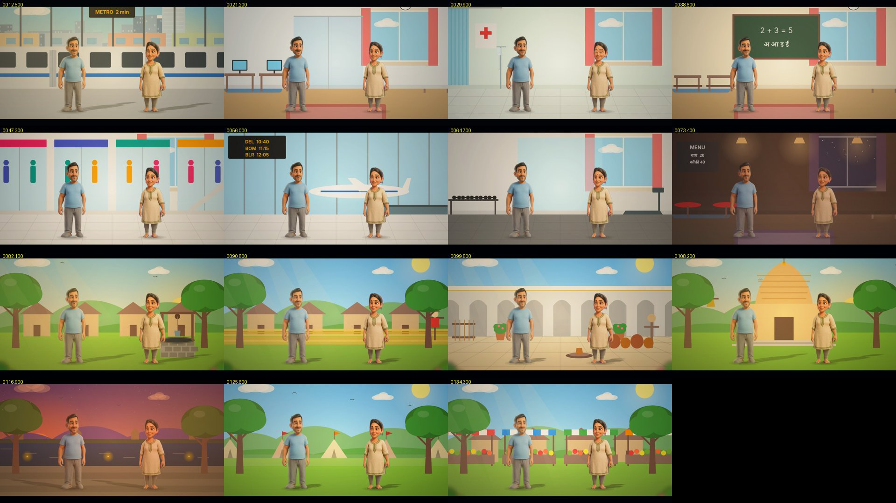

# Testing v45 — injuries and blood, deaths from many causes, 100,000 brand-new stories in new places

Your message: include injury and blood flowing where it is needed, and death scenes from various causes; write
100,000 absolutely new stories with unknown scenes — new modern and old situations — recheck them and hard-code what
they need.

What follows is what was built, how it was checked, what was wrong and fixed, and what is still not right.

## 1. Injuries and blood

* **A wound:** the hurt one winces (pain on the face) and puts a hand to it. Those near turn to them, alarmed.
* **Blood, where the words call for it:** blood that is named, or a wound from a weapon, a fall or an accident. A dark
  stain spreads at the part named (head, arm, leg, chest), a thin trickle runs from it, and drops fall to a small pool.
  An arrow wound shows the shaft standing in it. Kept to what a family film shows: no gore, no open wounds.
* **A bandage** ("पट्टी बाँधती है", "dresses the wound") stops the bleeding. The one who binds it goes to the hurt one,
  who holds out the hurt part. A wound that is not bleeding is dressed the same way, and is not read as a new wound.
* **A collapse that is not a death:** a heart attack or a faint is a hand to the chest, a stagger, the knees, then the
  ground. The nearest person runs to them and kneels beside them.

## 2. Deaths, by cause

| the words | what the film does |
|---|---|
| in bed, ill or old ("बीमारी के बाद चल बसता है", "passes away in his sleep") | a last breath, the eyes close — no stagger |
| the heart ("दिल का दौरा पड़ने से मृत्यु", "collapses with a heart attack and dies") | a hand to the chest, a stagger, the knees, down |
| a weapon (an arrow, a sword, a spear, a shot) or a snakebite | the wound bleeds, a stagger (or the leg seized), the knees, down |
| any other (an accident, drowning, a fall, fire, poison) | down on the knees, then lying still |

From the moment of death the dead lie still: no breath, no blink, no lips, nothing they do afterwards, the body where it
fell. The two nearest go to free places beside the head and past the feet, kneel and weep; the others stand in grief,
with tears. "सफ़ेद चादर ओढ़ा देता है" / "covers him with a white sheet" draws a white sheet over the body.

The figures of speech kill no one: "phone dies", "dying to see", "dies laughing", "plays dead", "मरा जा रहा है",
"मरने का नाटक", "stu**dies**" and "stu**died**". The last two were a real bug found by the generated stories: "Ishaan
studies for his exam" made him die, because the word "dies" sits inside "studies".

## 3. New places and situations

**Fifteen new places, each drawn as itself over its set:**

* Modern: a metro platform with a train standing at it; an office with desks and screens; a hospital ward with a drip
  stand, a curtain and a red cross; a classroom with a blackboard; a shopping mall with shop fronts and an escalator;
  an airport with a glass wall, a plane and the departures board; a gym; a restaurant.
* Old: a stone village well with its pulley and bucket; wheat fields with a scarecrow; a potter's yard with the wheel
  and pots; a temple with its spire, flag and bell; the river ghat with its steps and, at dusk, lamps on the water;
  battlefield tents and flags; a bazaar's stalls.

A shopping mall open for the day is a bright room; the closed one stays the dark basement.

**New sentences, 229 of them, Hindi and English** (`tools/testdata/v45probe`):

* Cuts, wounds and bandages; deaths of every cause above; mourning; the sentences that must not kill.
* The hospital, the office, a video call, a delivery, the metro, the mall, the airport, the gym, the classroom, the
  restaurant.
* The village well, the fields, the potter, the temple, the ghat, the battlefield, the bazaar, a letter by pigeon.
* Then a second batch: the lift, the ATM, the red light, crossing the road, the horn, the cinema, a wedding, a fire, a
  flood, a thief and the police; the hand-mill, the churn, the spinning wheel, a tonga, an oil lamp, a royal scroll; and
  deaths by a fall, fire, poison and a spear.

The first run passed 123 of 172 sentences. Each failure was given its words and its staging, among them:

* "वीरगति", "साँसें थम जाती हैं", "गुज़र जाता है" (but not "passes by"), "drowns".
* A heart attack without death; waking in the hospital bed; out of bed into a wheelchair.
* A handshake, a pulse felt, paying, bargaining, browsing, trying on a jacket.
* Drawing water, splashing the face, the plough, the harvest, resting in the shade, the potter's wheel, the conch.
* The temple bell, a holy dip, a charge with the sword, a shield raised against blows.
* Running down the stairs, a nearly-fall in a crowd (not eating: "धक्का खाकर" was read as "खाकर", eating).
* Pressing a button, the ATM, a stopped car at the red light, crossing the road, wading through water.
* The hand-mill, the churn, the spinning wheel, a scroll read aloud, the horn.

Now **229 of 229**. The older pools still pass: v43's **405 of 405**, v44's **118 of 118**.

## 4. 100,000 brand-new stories

The story generator (`tools/jvm/…/StoryForge.java`) now draws on all 752 sentences (v43 + v44 + v45). The new places
come with their own descriptions. A death ends the story: the dead never act or speak again, and a mourner says the
last line. Every film is checked: every direction staged in its window, and the film itself sound (nobody speaking
unseen, two people on one spot, riding two things at once, walking while seated, moving while lying, waiting off the
picture). Seeds never used before. 1,000 of the stories are kept in `tools/testdata/v45forge` to read; 114 of them end
in a death.

| | the first 100,000 (seeds 2,000,001–2,100,000) | the final 100,000 (seeds 3,000,001–3,100,000) |
|---|---|---|
| crashed | 0 | 0 |
| directions checked | 847,826 | 846,309 |
| staged as asked (pass) | 96.9 % | 97.0 % |
| state already held (context) | 2.7 % | 2.7 % |
| not staged (fail) | 0.4 % | 0.3 % |
| stories with a film fault | 907 | 916 |
| time | 16 ms a story | 16 ms a story |

Between the two, sample runs of 3,000–5,000 stories found the bugs below. The new sentences went from failing in 31
places to 3.

The faults still counted in the final run:

* Two people on one spot for a moment: 501 stories.
* An effect ending before it starts, in contrived chains of rides: 183.
* Waiting off the edge of the picture: 139.
* Speaking unseen: 57.
* A speaker never in the frame: 40.

The most frequent sentences still failing are older ones whose state already held, and which the checker cannot see
held:

* "आँगन में कुत्ता भौंकता है" with a dog already in the yard: it barks, but no new animal comes.
* Running to Mother when already beside her.
* The sun rising in a morning scene, or the evening sky in an evening one.

The new v45 sentences fail in at most 5 % of stories (the tonga ride), most of them never.

What the runs found, and what was fixed (each in many stories at once):

* Nobody **glides across the floor seated**: "flops down on the sofa", then "opens the door and goes out", slid him
  out seated. A move from a seat or a bed is now made on foot, decided sentence by sentence, so a later "sits down to
  rest" still sits. The stories with this fault went from 14 in 3,000 to none.
* Lying in a hospital bed, **"sits in a wheelchair"** did nothing, and he then rolled along lying down. He now gets out
  of the bed into the chair.
* **Someone off the stage** (ridden away on a motorbike) who is then wounded, or withdraws cash, walks back on first.
* **A death said twice in one sentence** ("आख़िरी साँस लेता है और दम तोड़ देता है") was two deaths and two
  weepings; now one.
* **"माँ के शव पर चादर"** in a story where Mother has a name: she is found by her relation, not only her name.
* **"walks to the reception desk"** turned his head and stayed; the walk is now made.
* Kneeling dolls in a **saree or long skirt** looked as if they were standing; the skirt now spreads on the ground.
* The checker was made fair: someone who uses a wheelchair (named so earlier in a generated story) rolls rather than
  runs, dances or kneels. That is what the director does, and the checker now accepts it.

## 5. Your pictures, frame by frame

* Four stories in `tools/testdata/v45stories`, rendered and looked at frame by frame:
  * a battle: the arrow in the chest, the bandage, the commander's death, the queen's white sheet;
  * an illness and a cut finger;
  * the metro, an office heart attack and the hospital;
  * the village well, the churn and the spinning wheel, the grandfather's death, the ghat at dusk.
* What the frames showed and what was changed:
  * The bleeding chest with the arrow in it.
  * The dead lying still with the eyes shut.
  * The mourners kneeling at the feet. They first knelt on the body; now they take distinct free places.
  * The sheet over the body. It first sat too low; it was raised and widened.
  * The new places.

## 6. The last checks, on the final code

* Sentences: v43 405 of 405, v44 118 of 118, v45 229 of 229.
* The 100,000 new stories (final run): 0 crashed; 97.0 % staged as asked, 2.7 % context, 0.3 % not staged.
* The app on the phone emulator (Robolectric): ROBO_LINE
* Version 45.0; the APK is `release/KahaniFilm.apk`.

## 7. Still not right

* Your pictures are flat. Their arms lift only so far, a kneel is a lower figure with shorter legs, and a glass reaches
  the lips only in a close-up.
* A wheelchair, crutches or a stick named in an action ("sits in a wheelchair") belongs to that person for the whole
  story, as for someone who uses one. A temporary wheelchair in a hospital is not yet told apart.
* The new places are drawn over the nearest of the old sets: the office keeps the room's window and rug, and the
  airport's floor is tiles over grass. They are not your own pictures. Upload a picture of a place and it is used
  instead.
* Generated stories chain sentences no one would write together. What still fails in them is listed in the table
  above, mostly a state that already held, or two people on one spot for a moment.

## 8. Said plainly — and sorry

* This is not a Pixar or Disney film maker, and I cannot make it one. The characters are your flat pictures on a fine
  mesh, the places are drawn, and the director works from rules for the words it knows, not from understanding the
  story.
* "No bug at all" is not something I can promise. 200,000 new stories this round found and fixed many mistakes, and
  others will remain. When you see one, tell me the sentence and what went wrong.
